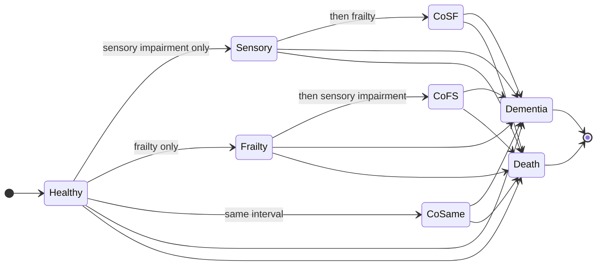

<div align="center">

# Temporal sequencing of sensory impairments and frailty reveals vulnerability-dependent dementia risk

### A two-cohort multi-state analysis in HRS (United States) and ELSA (England)

Reproducible `R` code accompanying the manuscript. The analysis traces how
**hearing and vision impairment** and **frailty** accumulate — and in **what order** —
on the path to **incident dementia** in two large longitudinal studies of older
adults.

<br>


</div>

---

## Overview

Older adults rarely acquire a single deficit in isolation. Sensory impairment
and frailty often co-occur, and the **sequence** in which they arise may carry
different risk for dementia. This repository builds harmonised cohorts from two
independent studies and models the transitions between health states over up to
~16 years of follow-up.

Two exposures (**hearing impairment**, **vision impairment**) are each analysed against
frailty and dementia, in each cohort, using an identical modelling template so
that findings can be compared across studies.

## The multi-state model at a glance

Each person occupies one of eight mutually exclusive states. Dementia and death
are absorbing. Co-occurrence of sensory impairment and frailty is split by
**which condition was reached first** — the question at the heart of the paper.

> **Note:** linked mortality data were not available in ELSA over the analysis
> window, so the ELSA model has seven states with dementia as the sole absorbing state. The
> eight-state model with death shown below is the HRS specification.



**State abbreviations.** Each co-occurrence state is named for the order in
which the two conditions were first observed:

| Label | Meaning |
|-------|---------|
| `Healthy` | No sensory impairment and no frailty |
| `Sensory` | Sensory impairment only |
| `Frailty` | Frailty only |
| `CoSF` | Co-occurrence, **S**ensory impairment first, then **F**railty |
| `CoFS` | Co-occurrence, **F**railty first, then **S**ensory impairment |
| `CoSame` | Co-occurrence, both first observed in the **same** assessment interval, so the order of onset cannot be determined |
| `Dementia` | Incident dementia (absorbing) |
| `Death` | Death from any cause (absorbing; HRS only) |


## Methods implemented

| Step | What the code does |
|------|--------------------|
| **Cohort construction** | Harmonises demographics, lifestyle, sensory, and cognition variables into one person-wave table per cohort; applies the eligibility flow (rolling baseline HRS 2004–2010 / ELSA 2002–2008, age ≥ 50, dementia-free at baseline, ≥ 2 valid waves, has follow-up). |
| **Frailty index** | Rockwood-style deficit-accumulation index (37 candidate deficits in HRS, 49 in ELSA), computed as accumulated deficits over non-missing items and requiring ≥ 80% item completeness, with a ≥ 0.25 cut-off for frailty. Self-rated health is graded on a five-level scale in HRS (0, 0.25, 0.50, 0.75, 1) and coded fair/poor = 1 in ELSA; other deficits are binary. Two sensitivity indices are computed alongside it: one without the ADL/IADL items, and a reduced index without the (I)ADL items and the affective CES-D items (22 items in HRS, 31 in ELSA). |
| **Dementia ascertainment** | HRS: Langa–Weir cognitive classification. ELSA: self-reported physician diagnosis combined with the 16-item IQCODE (mean ≥ 3.4 over the items answered). Dementia is made irreversible (`cummax`). |
| **Missing data** | Multiple imputation by chained equations (`mice`, `m = 20`, 10 iterations), fitted separately at each wave of each cohort — predictive mean matching for continuous variables, proportional-odds regression for education, logistic regression for binary variables. Sex and race/ethnicity are imputed inside the fully conditional specification so no predictor carries missing values into the design matrix, but are not written back to the analysis data. The primary study variables (frailty index, sensory impairment, dementia) are neither imputed nor used as predictors. A single completed dataset is carried forward; the `mids` objects are retained for optional pooled inference. |
| **Multi-state models** | 8-state continuous-time, time-homogeneous Markov models (`msm`) with dementia and death as absorbing states (7 states in ELSA, where mortality follow-up is incomplete); reversals and transitions bypassing the single-condition intermediate states are fixed at zero. Unadjusted and covariate-adjusted fits (age, sex, race/ethnicity, education, marital status; effects constrained equal within transition groups). Yields transition intensities, transition-rate ratios, covariate hazard ratios, and 5- and 10-year transition-probability matrices. |
| **Survival models** | Time-varying Cox proportional-hazards models in counting-process format with one-wave lagged exposures, Efron ties, and cluster-robust standard errors. Models 1–4 apply progressive adjustment on a common complete-case sample; Model 4 is also fitted with a sensory × frailty interaction (ratio of HRs and RERI). Model 5 replaces the binary sensory exposure with a three-level term contrasting sensory impairment before or without subsequent frailty onset against sensory impairment with or subsequent to frailty onset. Kaplan–Meier cumulative incidence by baseline status. |
| **Attributable burden** | Population attributable fractions (Levin's formula) using person-time-weighted exposure prevalence, with Monte Carlo confidence intervals (10,000 draws; multivariate-normal for the three-level exposure so the correlation among stratum coefficients is preserved). Parametric g-formula PAFs at 10 and 16 years (bootstrap CIs) as a risk-based check on the Levin PAFs. |
| **Sensitivity analyses** | Age (< 65 / ≥ 65) and sex subgroups with interaction tests; multi-state models allowing recovery (backward transitions); Fine–Gray sub-distribution hazards with death as the competing event (HRS only); exposures and time-varying covariates lagged by two waves; the reduced frailty index; and attained age as the time scale. |
| **Figures** | Forest plots, PAF plots, cumulative-incidence curves, and transition-probability heatmaps for the main text and supplement. |

## Repository structure

```
.
├── code/
│   ├── HRS_dataextract.Rmd    # Build harmonised HRS person-wave data (→ hrs_long.csv, death_track.rds, …)
│   ├── ELSA_extractdata.Rmd   # Build harmonised ELSA person-wave data (→ elsa_long.csv, …)
│   ├── HRS_analysis_MSM.Rmd   # HRS: eligibility, Table 1, multi-state models
│   ├── HRS_analysis_Cox.Rmd   # HRS: Cox models 1–5, PAF, g-formula, sensitivity analyses
│   ├── ELSA_analysis_MSM.Rmd  # ELSA: eligibility, Table 1, multi-state models
│   ├── ELSA_analysis_Cox.Rmd  # ELSA: Cox models 1–5, PAF, g-formula, sensitivity analyses
│   └── Plot.Rmd               # Figs 3–4 and Supplementary Figs 9–17
├── demo/
│   ├── simulate_demo_data.R   # Generates the simulated demo dataset
│   ├── hrs_long.csv           # Pre-generated simulated HRS panel (600 people)
│   ├── elsa_long.csv          # Pre-generated simulated ELSA panel (600 people)
│   ├── death_track.rds        # Pre-generated simulated mortality table
│   └── *_fi_*.csv, hrs_age_months.csv  # Pre-generated simulated inputs for the sensitivity analyses
├── DATA_AVAILABILITY.md       # How to obtain HRS and ELSA data
├── LICENSE                    # MIT
└── README.md
```

The two analysis notebooks of each cohort share an identical setup section
(data load, cohort construction and, in HRS, death tracking), so each runs on
its own in a fresh session.

> `data/`, `output/`, `results/`, and all `.csv`/`.dta` files are
> **git-ignored** — no participant data ever enter the repository.

## 1. System requirements

### Software dependencies

**R 4.4.0** (minimum 4.2) and the following packages. Versions listed are those
present in the environment used to run the analyses:

| Package | Version | | Package | Version |
|---------|---------|-|---------|---------|
| `tidyverse` | 2.0.0 | | `msm` | 1.9 |
| `dplyr` | 1.1.4 | | `survival` | 3.7.0 |
| `haven` | 2.5.5 | | `survminer` | 0.4.9 |
| `labelled` | 2.13.0 | | `MASS` | 7.3.65 |
| `stringr` | 1.5.1 | | `broom` | 1.0.8 |
| `lubridate` | 1.9.5 | | `car` | 3.1.3 |
| `mice` | 3.19.0 | | `scales` | 1.3.0 |
| `patchwork` | 1.3.0 | | `ggalluvial` | 0.12.6 |
| `forestploter` | 1.1.3 | | `ragg` | 1.3.0 |

`MASS`, `lattice` (0.22.6) and `grid` ship with R as recommended packages;
`MASS` is listed because its `mvrnorm()` is load-bearing for the disaggregated
PAF confidence intervals, not incidental. RStudio is optional and only needed to
run the `.Rmd` notebooks interactively.

### Operating system

Tested on **macOS 15.6.1** (Apple silicon, `aarch64-apple-darwin20`) with
R 4.4.0 — the platform on which the reported results were produced.

No platform-specific code, system calls, or compiled components are used, so the
notebooks are expected to run on Linux and on Windows 10/11 with the same
package versions. Neither has been formally tested.

### Hardware

No non-standard hardware is required. The full analysis was run on a laptop
with 16 GB RAM. Peak memory use is dominated by reading the RAND HRS
longitudinal file (~2 GB in memory), so **8 GB RAM is the practical minimum**
for the extraction notebooks; the analysis notebooks alone need ~2 GB, plus
about 1 GB for each parallel worker of the g-formula bootstrap (up to 4, via
base R `parallel`). No GPU or cluster is needed.

## 2. Installation guide

No compilation or build step is required — this is R source code, not a
packaged tool. Installation consists of installing R and the dependencies.

```r
# 1. Install R >= 4.2 from https://cran.r-project.org

# 2. Install the package dependencies
install.packages(c(
  "haven", "dplyr", "tidyverse", "labelled", "stringr", "mice", "lubridate",
  "msm", "survival", "survminer", "scales", "patchwork", "ggalluvial",
  "forestploter", "broom", "car", "MASS", "ragg"
))

# 3. Clone or download this repository, then set the repository root as the
#    working directory. All paths in the code are relative to it.
setwd("/path/to/SZ_et_al_Nature_Aging_2026-main")   # the folder name after
#   downloading the ZIP from GitHub; a git clone gives "SZ_et_al_Nature_Aging_2026"
```

**Typical install time on a normal desktop computer: 5–10 minutes** on macOS or
Windows, where CRAN serves pre-compiled binaries. On Linux, where packages build
from source, allow **25–45 minutes**. R itself installs in 2–5 minutes. These
are estimates for a machine with a normal broadband connection, not measured
benchmarks.

To pin the exact versions above rather than installing current CRAN releases:

```r
install.packages("remotes")
remotes::install_version("mice", version = "3.16.0")   # and so on per package
```

## 3. Demo

Because HRS and ELSA prohibit redistribution of participant data, this
repository ships a **generator for a small simulated dataset** instead of a real
extract. The simulated files use exactly the schema the analysis notebooks
expect, so the notebooks run **unmodified** on them.

The simulated files are committed under `demo/` so they can be inspected without
running anything, and `demo/simulate_demo_data.R` regenerates them from a fixed
seed. Values are entirely synthetic: no value derives from any real participant,
and the data are **not** calibrated to reproduce the published effect sizes.

Both simulated cohorts contain 600 people. The size is chosen to be large enough
that every model in the notebooks — including the eight-state Markov model,
which needs each of its states to be populated — converges and returns finite
estimates. It carries no relationship to the real cohort sizes.

### Run the demo

**Step 1 — generate the simulated data.** In R or RStudio, set the working
directory to the repository root and run:

```r
setwd("/path/to/SZ_et_al_Nature_Aging_2026-main")   # folder name from the GitHub ZIP
source("demo/simulate_demo_data.R")
```

This writes the simulated files into `data/`, where the notebooks look for them.
(If you prefer the command line, `Rscript demo/simulate_demo_data.R` from the
repository root does the same thing.) The extraction notebooks are not part of
the demo: the simulated files stand in for their output.

**Step 2 — run the analysis notebooks.** Open any of
`code/HRS_analysis_MSM.Rmd`, `code/HRS_analysis_Cox.Rmd`,
`code/ELSA_analysis_MSM.Rmd` and `code/ELSA_analysis_Cox.Rmd` in RStudio and run
all chunks (Run ▸ Run All), or knit the notebook. Each one runs on its own in a
fresh session. Run `code/Plot.Rmd` last, after both Cox notebooks, because it
draws the figures from the files they save in `results/`.

You do **not** need to change the working directory for the notebooks. RStudio
runs `.Rmd` chunks from the notebook's own folder (`code/`), so each notebook
resolves the repository root itself in its first chunk and prints it:

```
Repository root: /path/to/SZ_et_al_Nature_Aging_2026-main
```

All later paths are built from that, so `data/` is found whether you run the
notebook from the repository root, from `code/`, or by knitting. Tables and
model fits are written to `results/` and figures to `output/`.

### Expected output

`demo/simulate_demo_data.R` writes the simulated files and prints a summary:

```
Simulated demo data written to data/
  data/hrs_long.csv       4936 rows, 600 people,  9 waves (2004-2020)
  data/death_track.rds     600 people, 158 deaths (135 by the 2020 wave)
  data/hrs_age_months.csv, data/hrs_fi_reduced.csv, data/hrs_fi_item_counts.csv
  data/elsa_long.csv      5384 rows, 600 people,  9 waves (2002-2018)
  data/elsa_fi_reduced.csv, data/elsa_fi_item_counts.csv

  HRS  person-waves with dementia: 327 (14.5% of people ever affected)
  ELSA person-waves with dementia: 287 (12.2% of people ever affected)
```

The generator is seeded (`set.seed(2026)`), so these counts are reproducible
exactly.

On these files the notebooks produce, in order:

- **`*_analysis_MSM.Rmd`** — the exclusion-flow and baseline-year tables,
  **Table 1** (baseline characteristics, follow-up time and dementia incidence
  per 100 person-years), the multi-state models for hearing and vision
  (transition-intensity matrices, transition-rate ratios with 95% CIs, covariate
  hazard ratios, 5- and 10-year transition-probability matrices and heatmaps),
  and the backward-transition sensitivity models.
- **`*_analysis_Cox.Rmd`** — Cox Models 1–5 with cluster-robust 95% CIs and
  `cox.zph()` tests, the sensory × frailty interaction, multicollinearity
  checks, Levin and g-formula PAFs, cumulative-incidence curves, subgroup
  analyses, and the sensitivity analyses (Fine–Gray in HRS, two-wave lag,
  reduced frailty index, attained age).
- **`Plot.Rmd`** — Figs 3–4 and Supplementary Figs 9–17.

Because the demo data are simulated, the *values* differ from the manuscript,
and some models print warnings about sparse cells (for example, the g-formula
notes that few participants remain in the last interval). What the demo
demonstrates is that every model specification fits and returns finite
estimates with plausible structure.

### Expected run time

Measured on a Linux machine (4 cores, 16 GB RAM, R 4.3.3, msm 1.7.1) with the
notebooks running side by side, using the default settings, including `B = 200`
g-formula bootstrap replicates on 3 parallel workers:

| Step | Time |
|------|------|
| `demo/simulate_demo_data.R` | ~1 second |
| `code/HRS_analysis_MSM.Rmd` | ~70 minutes |
| `code/HRS_analysis_Cox.Rmd` | ~9 minutes |
| `code/ELSA_analysis_MSM.Rmd` | ~15 minutes |
| `code/ELSA_analysis_Cox.Rmd` | ~10 minutes |
| `code/Plot.Rmd` | ~30 seconds |

Most of the time goes to the backward-transition multi-state models and to the
g-formula bootstrap in the Cox notebooks. With msm ≥ 1.9, the HRS notebook saves
the unadjusted backward-transition fits and reuses them when it is re-run on the
same data. For a quick check, set `B = 0L` in the `GF <- list(...)` settings
chunk of each Cox notebook to compute g-formula point estimates only; this skips
the bootstrap confidence intervals.

## 4. Instructions for use

To run on the real cohort data:

**Step 1 — obtain the source data.** HRS and ELSA are restricted-access but free
to approved researchers. Follow [`DATA_AVAILABILITY.md`](DATA_AVAILABILITY.md),
then place the files under a local `data/` directory so the relative paths in the
code resolve:

```
data/
├── HRS/                       # RAND HRS + Fat/Track/Langa–Weir files
│   ├── randhrs1992_2022v1_STATA/
│   ├── LangaWeir2022v1/
│   ├── trk2022v1/
│   └── h0Nf*_STATA/ ...
└── ELSA/
    └── UKDA-5050-stata/stata/stata13_se/
```

`data/`, `output/`, `results/`, and all `.csv`/`.dta` files are git-ignored, so
participant data can never enter the repository.

**Step 2 — run the notebooks in order.** Later notebooks read files written by
earlier ones:

```
1. code/HRS_dataextract.Rmd    →  data/hrs_long.csv, data/death_track.rds,
                                  data/hrs_age_months.csv, data/hrs_fi_reduced.csv
2. code/ELSA_extractdata.Rmd   →  data/elsa_long.csv, data/elsa_fi_reduced.csv
3. code/HRS_analysis_MSM.Rmd   →  multi-state models + tables (HRS)
4. code/HRS_analysis_Cox.Rmd   →  Cox models, PAF, sensitivity analyses (HRS)
5. code/ELSA_analysis_MSM.Rmd  →  multi-state models + tables (ELSA)
6. code/ELSA_analysis_Cox.Rmd  →  Cox models, PAF, sensitivity analyses (ELSA)
7. code/Plot.Rmd               →  figures (reads results/ from steps 4 and 6)
```

Steps 1 and 2 are independent of each other, as are steps 3–6. Each analysis
notebook reads its inputs from `data/` rather than relying on objects left in
the session by an earlier notebook, and asserts one row per participant-wave
before proceeding, so each notebook can be run in a fresh session.

**Applying the code to a different cohort.** The extraction notebooks are
specific to the HRS and ELSA variable names and would need rewriting. The
analysis notebooks are not: they consume a single person-wave table with the
columns `id`, `year`, `age`, `dementia`, `hearing_loss`, `vision_overall`,
`Frailty_status`, `FI_score`, and the covariate set, plus an optional mortality
table. Any cohort reshaped into that schema — the schema
`demo/simulate_demo_data.R` documents — can be run through the same models.

### Run time on the real data

On the full HRS (n = 22,756) and ELSA (n = 12,921) cohorts, the extraction
notebooks take the order of tens of minutes each: they read the RAND HRS
longitudinal file and the nine ELSA wave files from disk and fit nine waves ×
20 multiply-imputed datasets. The multi-state notebooks take longer than on the
demo data, mostly in the backward-transition models. The g-formula
bootstrap in the Cox notebooks (12 models × 201 fits) can take several hours.
Its results are cached in `results/gf_cache_*`, so an interrupted run resumes
where it stopped. Actual times scale with the number of cores, disk speed and
available RAM.

## 5. Reproduction instructions

To reproduce the quantitative results in the manuscript, run the seven notebooks
in the order above on the full cohort data. Each manuscript item maps to a
specific notebook section:

| Manuscript item | Where it is produced |
|-----------------|----------------------|
| Table 1 (participant characteristics) | `*_analysis_MSM.Rmd` → "Table 1" chunk |
| Supplementary Tables 1–4 (exclusion flow, baseline year) | `*_analysis_MSM.Rmd` → exclusion-flow and baseline-year chunks |
| Supplementary Table 12 (assessments attended and follow-up) | `*_analysis_Cox.Rmd` → "Attendance and follow-up" chunk |
| Fig. 1, Fig. 2, Supplementary Figs 7–8, Supplementary Tables 13–16 (HRS) and 19–22 (ELSA) | `*_analysis_MSM.Rmd` → `msm`, `qratio.msm` and `pmatrix.msm` chunks and the heatmap chunk |
| Supplementary Tables 17–18 (HRS) and 23–24 (ELSA): reverse transitions | `*_analysis_MSM.Rmd` → reverse-transition chunks |
| Supplementary Tables 25–28 (HRS) and 29–32 (ELSA): backward-transition models | `*_analysis_MSM.Rmd` → backward-transition sensitivity chunks |
| Fig. 3, Supplementary Table 33 (Models 1–4 HRs and PAFs) | `*_analysis_Cox.Rmd` → Cox Models 1–4 and PAF chunks; figure in `Plot.Rmd` |
| Supplementary Tables 34–35 (interaction, multicollinearity) | `*_analysis_Cox.Rmd` → interaction and pre-flight chunks |
| Supplementary Tables 36–39 (g-formula PAFs and risks) | `*_analysis_Cox.Rmd` → g-formula chunks |
| Fig. 4, Supplementary Tables 40–42 (Model 5) | `*_analysis_Cox.Rmd` → Model 5 chunks; figure in `Plot.Rmd` |
| Supplementary Figs 1–6 (cumulative incidence) | `*_analysis_Cox.Rmd` → Kaplan–Meier chunk |
| Supplementary Fig. 9 (age and sex subgroups) | `*_analysis_Cox.Rmd` → subgroup chunks; figure in `Plot.Rmd` |
| Supplementary Tables 43–44, Supplementary Figs 10–11 (Fine–Gray, HRS) | `HRS_analysis_Cox.Rmd` → Fine–Gray chunks; figures in `Plot.Rmd` |
| Supplementary Tables 45–46, Supplementary Figs 12–13 (two-wave lag) | `*_analysis_Cox.Rmd` → two-wave lag chunks; figures in `Plot.Rmd` |
| Supplementary Tables 47–48, Supplementary Figs 14–15 (reduced frailty index) | `*_analysis_Cox.Rmd` → reduced frailty index chunks; figures in `Plot.Rmd` |
| Supplementary Table 49, Supplementary Figs 16–17 (attained age) | `*_analysis_Cox.Rmd` → attained-age chunks; figures in `Plot.Rmd` |

Random seeds are set wherever a stochastic procedure is used (multiple
imputation, the Monte Carlo draws behind the PAF confidence intervals, and the
g-formula simulation and bootstrap), so repeated runs on the same input data
reproduce the same numbers.

## Data availability

No participant-level data are shared here. Both cohorts prohibit
redistribution; obtain them directly from the providers:

- **HRS** — [hrsdata.isr.umich.edu](https://hrsdata.isr.umich.edu) (University of Michigan)
- **ELSA** — [UK Data Service, study SN 5050](https://ukdataservice.ac.uk)

Full file-level details are in [`DATA_AVAILABILITY.md`](DATA_AVAILABILITY.md).

## Citation

If you use this code, please cite the accompanying manuscript.
A full citation and DOI will be added here on publication.

## License

Released under the [MIT License](LICENSE). The license covers the code in this
repository only; it does not grant any rights to the underlying HRS or ELSA data.

## Questions

Please open an [issue](../../issues) rather than emailing, so that answers stay
searchable for others reproducing the work.
