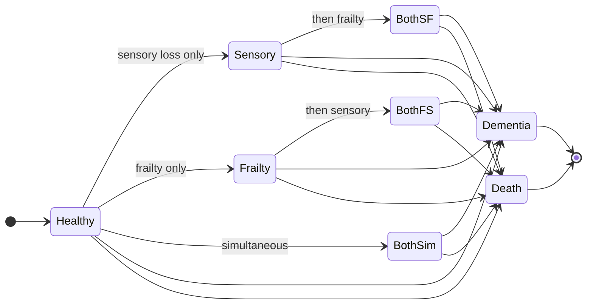

<div align="center">

# Temporal sequencing of sensory impairments and frailty reveals vulnerability-dependent dementia risk

### A two-cohort multi-state analysis in HRS (United States) and ELSA (England)

Reproducible `R` code accompanying the manuscript. The analysis traces how
**hearing and vision loss** and **frailty** accumulate — and in **what order** —
on the path to **incident dementia** and **death** in two large longitudinal
studies of older adults.

<br>


</div>

---

## Overview

Older adults rarely acquire a single deficit in isolation. Sensory impairment
and frailty often co-occur, and the **sequence** in which they arise may carry
different risk for dementia. This repository builds harmonised cohorts from two
independent studies and models the transitions between health states over up to
~16 years of follow-up.

Two exposures (**hearing loss**, **vision loss**) are each analysed against
frailty and dementia, in each cohort, using an identical modelling template so
that findings can be compared across studies.

## The multi-state model at a glance

Each person occupies one of eight mutually exclusive states. Dementia and death
are absorbing. The "both" state is split by **which deficit came first** — the
question at the heart of the paper.



## Methods implemented

| Step | What the code does |
|------|--------------------|
| **Cohort construction** | Harmonises demographics, lifestyle, sensory, and cognition variables into one person-wave table per cohort; applies the eligibility flow (age ≥ 50, dementia-free at baseline, ≥ 2 valid waves, has follow-up). |
| **Frailty index** | Rockwood-style deficit-accumulation index (37 candidate deficits in HRS, 49 in ELSA), computed as accumulated deficits over non-missing items and requiring ≥ 80% item completeness, with a ≥ 0.25 cut-off for frailty. Self-rated health is graded on a five-level scale (0, 0.25, 0.50, 0.75, 1); other deficits are binary. A sensitivity index removing all ADL and IADL items is computed alongside it. |
| **Dementia ascertainment** | HRS: Langa–Weir cognitive classification. ELSA: physician diagnosis combined with the 16-item IQCODE (mean ≥ 3.4, from ≥ 10 valid items). Dementia is made irreversible (`cummax`). |
| **Missing data** | Multiple imputation by chained equations (`mice`, `m = 20`, 10 iterations), fitted separately at each wave of each cohort — predictive mean matching for continuous variables, proportional-odds regression for education, logistic regression for binary variables. Sex and race/ethnicity are imputed inside the fully conditional specification so no predictor carries missing values into the design matrix, but are not written back to the analysis data. The primary study variables (frailty index, sensory impairment, dementia) are neither imputed nor used as predictors. A single completed dataset is carried forward; the `mids` objects are retained for optional pooled inference. |
| **Multi-state models** | 8-state continuous-time, time-homogeneous Markov models (`msm`) with dementia and death as absorbing states (7 states in ELSA, where mortality follow-up is incomplete); reversals and transitions bypassing the single-condition intermediate states are fixed at zero. Yields transition-rate ratios and 5- and 10-year transition-probability matrices. |
| **Survival models** | Time-varying Cox proportional-hazards models in counting-process format with one-wave lagged exposures, Efron ties, and cluster-robust standard errors. Models 1–4 apply progressive adjustment on a common complete-case sample; Model 5 replaces the binary sensory exposure with a three-level term contrasting person-time before frailty onset against person-time with concurrent or prior frailty. |
| **Attributable burden** | Population attributable fractions (Levin's formula) using person-time-weighted exposure prevalence, with Monte Carlo confidence intervals (10,000 draws; multivariate-normal for the three-level exposure so the correlation among stratum coefficients is preserved). |
| **Sensitivity analyses** | Age (< 65 / ≥ 65) and sex subgroups with interaction tests; the (I)ADL-removed frailty index; Fine–Gray sub-distribution hazards with death as the competing event (HRS only); and exclusion of dementia ascertained within the first two waves. |
| **Figures** | Forest plots, PAF plots, and transition-probability heatmaps for the main text and supplement. |

## Repository structure

```
.
├── code/
│   ├── HRS_dataextract.Rmd    # Build harmonised HRS person-wave data (→ hrs_long.csv)
│   ├── ELSA_extractdata.Rmd   # Build harmonised ELSA person-wave data (→ elsa_long.csv)
│   ├── HRS_analysis.Rmd       # HRS: eligibility, Table 1, msm, Cox
│   ├── ELSA_analysis.Rmd      # ELSA: eligibility, Table 1, msm, Cox
│   └── Plot.Rmd               # Manuscript figures
├── demo/
│   ├── simulate_demo_data.R   # Generates the simulated demo dataset
│   ├── hrs_long.csv           # Pre-generated simulated HRS panel (600 people)
│   ├── elsa_long.csv          # Pre-generated simulated ELSA panel (500 people)
│   └── death_track.rds        # Pre-generated simulated mortality table
├── DATA_AVAILABILITY.md       # How to obtain HRS and ELSA data
├── LICENSE                    # MIT
└── README.md
```

> `data/`, `output/`, `results/`, and all `.csv`/`.dta` files are
> **git-ignored** — no participant data ever enter the repository.

## 1. System requirements

### Software dependencies

**R 4.4.0** (minimum 4.2) and the following packages. Versions listed are those
present in the environment used to run the analyses:

| Package | Version | | Package | Version |
|---------|---------|-|---------|---------|
| `tidyverse` | 2.0.0 | | `msm` | 1.8.2 |
| `dplyr` | 1.1.4 | | `survival` | 3.7.0 |
| `haven` | 2.5.5 | | `survminer` | 0.4.9 |
| `labelled` | 2.13.0 | | `MASS` | 7.3.65 |
| `stringr` | 1.5.1 | | `broom` | 1.0.8 |
| `lubridate` | 1.9.5 | | `car` | 3.1.3 |
| `mice` | 3.19.0 | | `scales` | 1.3.0 |
| `patchwork` | 1.3.0 | | `ggalluvial` | 0.12.6 |
| `forestploter` | 1.1.3 | | `ragg` | 1.3.0 |

`MASS`, `lattice` (0.22.6) and `grid` ship with R as recommended packages;
`MASS` is listed because its `mvrnorm()` is load-bearing for the disaggregated
PAF confidence intervals, not incidental. RStudio is optional and only needed to
run the `.Rmd` notebooks interactively.

### Operating system

Tested on **macOS 15.6.1** (Apple silicon, `aarch64-apple-darwin20`) with
R 4.4.0 — the platform on which the reported results were produced.

No platform-specific code, system calls, or compiled components are used, so the
notebooks are expected to run on Linux and on Windows 10/11 with the same
package versions. Neither has been formally tested.

### Hardware

No non-standard hardware is required. The full analysis was run on a laptop
with 16 GB RAM. Peak memory use is dominated by reading the RAND HRS
longitudinal file (~2 GB in memory), so **8 GB RAM is the practical minimum**
for the extraction notebooks; the analysis notebooks alone need ~2 GB. No GPU,
cluster, or parallel backend is used.

## 2. Installation guide

No compilation or build step is required — this is R source code, not a
packaged tool. Installation consists of installing R and the dependencies.

```r
# 1. Install R >= 4.2 from https://cran.r-project.org

# 2. Install the package dependencies
install.packages(c(
  "haven", "dplyr", "tidyverse", "labelled", "stringr", "mice", "lubridate",
  "msm", "survival", "survminer", "scales", "patchwork", "ggalluvial",
  "forestploter", "broom", "car", "MASS", "ragg"
))

# 3. Clone or download this repository, then set the repository root as the
#    working directory. All paths in the code are relative to it.
setwd("/path/to/SZ_et_al_Nature_Aging_2026")
```

**Typical install time on a normal desktop computer: 5–10 minutes** on macOS or
Windows, where CRAN serves pre-compiled binaries. On Linux, where packages build
from source, allow **25–45 minutes**. R itself installs in 2–5 minutes. These
are estimates for a machine with a normal broadband connection, not measured
benchmarks.

To pin the exact versions above rather than installing current CRAN releases:

```r
install.packages("remotes")
remotes::install_version("mice", version = "3.16.0")   # and so on per package
```

## 3. Demo

Because HRS and ELSA prohibit redistribution of participant data, this
repository ships a **generator for a small simulated dataset** instead of a real
extract. The simulated files use exactly the schema the analysis notebooks
expect, so the notebooks run **unmodified** on them.

The simulated files are committed under `demo/` so they can be inspected without
running anything, and `demo/simulate_demo_data.R` regenerates them from a fixed
seed. Values are entirely synthetic: no value derives from any real participant,
and the data are **not** calibrated to reproduce the published effect sizes.

### Run the demo

```bash
# from the repository root — regenerates demo/ into data/ where the notebooks look
Rscript demo/simulate_demo_data.R
```

Or, to use the committed copies without regenerating them:

```bash
mkdir -p data && cp demo/hrs_long.csv demo/elsa_long.csv demo/death_track.rds data/
```

Then open `code/HRS_analysis.Rmd` (and/or `code/ELSA_analysis.Rmd`) and run the
chunks, or from the command line:

```bash
Rscript -e 'rmarkdown::render("code/HRS_analysis.Rmd")'
```

**Chunk order.** The two composite-figure chunks that assemble the hearing and
vision panels side by side (`panel_A`, `P5_vis`, `P10_vis`) depend on the vision
multi-state model, which is fitted in a later chunk. Run the vision multi-state
chunks before those figure chunks, or run the notebook's statistical chunks
first and the figure chunks last. All model output — Table 1, the multi-state
estimates, Cox Models 1–5, PAFs, subgroups, and the sensitivity analyses — is
independent of the figure chunks.

### Expected output

`demo/simulate_demo_data.R` writes three files and prints a summary:

```
Simulated demo data written to data/
  data/hrs_long.csv       5400 rows, 600 people,  9 waves (2004-2020)
  data/death_track.rds     600 people, 186 deaths
  data/elsa_long.csv      4489 rows, 500 people,  9 waves (2002-2018)

  HRS  person-waves with dementia: 416 (17.8% of people ever affected)
  ELSA person-waves with dementia: 312 (16.4% of people ever affected)
```

The generator is seeded (`set.seed(2026)`), so these counts are reproducible
exactly.

Running `HRS_analysis.Rmd` on these files then produces, in order:

1. an **exclusion-flow table** (~596 of 600 simulated participants eligible)
2. **Table 1** — baseline characteristics, follow-up time, and dementia
   incidence rate per 100 person-years
3. **8-state multi-state model** output — an 8 × 8 transition-intensity matrix,
   transition-rate ratios with 95% CIs, and 5- and 10-year transition-
   probability matrices
4. **Cox models 1–5** — hazard ratios with cluster-robust 95% CIs, plus
   `cox.zph()` proportional-hazards tests
5. **PAF tables** for Models 1–4 (binary exposures) and Model 5 (three-level
   exposure, with component PAFs summing to the total)
6. **subgroup and sensitivity analyses**

Because the demo data are simulated, the *values* differ from the manuscript.
What the demo demonstrates is that every model specification fits and returns
finite estimates with plausible structure — for example, Model 5 on the
simulated data returns a hazard ratio below 1 for sensory impairment during
person-time before frailty onset and above 1 for person-time with concurrent or
prior frailty, the same qualitative pattern reported in the paper.

### Expected run time

Measured on a 2021 MacBook Pro (Apple M1 Pro, 10 cores, 16 GB RAM,
macOS 15.6.1, R 4.4.0):

| Step | Time |
|------|------|
| `demo/simulate_demo_data.R` | ~1 second |
| `code/HRS_analysis.Rmd` (all models) | ~22 seconds |
| `code/ELSA_analysis.Rmd` (all models) | ~8 seconds |

**Total demo run time: under 1 minute.** Expect roughly 2–3× these times on an
older x86 laptop.

## 4. Instructions for use

To run on the real cohort data:

**Step 1 — obtain the source data.** HRS and ELSA are restricted-access but free
to approved researchers. Follow [`DATA_AVAILABILITY.md`](DATA_AVAILABILITY.md),
then place the files under a local `data/` directory so the relative paths in the
code resolve:

```
data/
├── HRS/                       # RAND HRS + Fat/Track/Langa–Weir files
│   ├── randhrs1992_2022v1_STATA/
│   ├── LangaWeir2022v1/
│   ├── trk2022v1/
│   └── h0Nf*_STATA/ ...
└── ELSA/
    └── UKDA-5050-stata/stata/stata13_se/
```

`data/`, `output/`, `results/`, and all `.csv`/`.dta` files are git-ignored, so
participant data can never enter the repository.

**Step 2 — run the notebooks in order.** Later notebooks read files written by
earlier ones:

```
1. code/HRS_dataextract.Rmd    →  data/hrs_long.csv, data/death_track.rds
2. code/ELSA_extractdata.Rmd   →  data/elsa_long.csv
3. code/HRS_analysis.Rmd       →  models + tables (HRS)
4. code/ELSA_analysis.Rmd      →  models + tables (ELSA)
5. code/Plot.Rmd               →  figures
```

Steps 1 and 2 are independent of each other, as are steps 3 and 4.
`HRS_analysis.Rmd` reads `data/death_track.rds` from disk rather than relying on
objects left in the session by step 1, and asserts one row per participant-wave
before proceeding, so each notebook can be run in a fresh session.

**Applying the code to a different cohort.** The extraction notebooks are
specific to the HRS and ELSA variable names and would need rewriting. The
analysis notebooks are not: they consume a single person-wave table with the
columns `id`, `year`, `age`, `dementia`, `hearing_loss`, `vision_overall`,
`Frailty_status`, `FI_score`, and the covariate set, plus an optional mortality
table. Any cohort reshaped into that schema — the schema
`demo/simulate_demo_data.R` documents — can be run through the same models.

### Run time on the real data

On the full HRS (n = 22,756) and ELSA (n = 12,921) cohorts, run time is
dominated by the extraction step rather than the modelling: reading the RAND HRS
longitudinal file and the nine ELSA wave files from disk, and fitting nine waves
× 20 multiply-imputed datasets. Expect the two extraction notebooks to take the
order of tens of minutes each on the machine specified above, and the two
analysis notebooks a few minutes each — the models themselves are fast, as the
demo timings show. Actual times scale with disk speed and available RAM.

## 5. Reproduction instructions

To reproduce the quantitative results in the manuscript, run the five notebooks
in the order above on the full cohort data. Each manuscript item maps to a
specific notebook section:

| Manuscript item | Where it is produced |
|-----------------|----------------------|
| Table 1 (participant characteristics) | `*_analysis.Rmd` → "Table 1" chunk |
| Exclusion flow (Supplementary Tables 1–4) | `*_analysis.Rmd` → "Exclusion flow" chunk |
| Fig. 1 (transition intensities) | `*_analysis.Rmd` → `msm` chunks; `Plot.Rmd` |
| Fig. 2 (5- and 10-year transition probabilities) | `*_analysis.Rmd` → `pmatrix.msm` chunks |
| Fig. 3 (Models 1–4 HRs and PAFs) | `*_analysis.Rmd` → Cox Models 1–4 and PAF chunks |
| Fig. 4 (frailty-context HRs and PAFs) | `*_analysis.Rmd` → Model 5 and Model 5 PAF chunks |
| Supplementary Fig. 7 (subgroups) | `*_analysis.Rmd` → subgroup chunks |
| Competing-risk sensitivity analysis | `HRS_analysis.Rmd` → Fine–Gray chunks |
| (I)ADL-removed frailty index sensitivity | `*_analysis.Rmd` → noIADL chunks |
| Early-dementia-exclusion sensitivity | `*_analysis.Rmd` → lag-restricted chunks |

Random seeds are set wherever a stochastic procedure is used (multiple
imputation, and the Monte Carlo draws behind the PAF confidence intervals), so
repeated runs on the same input data reproduce the same numbers.

## Data availability

No participant-level data are shared here. Both cohorts prohibit
redistribution; obtain them directly from the providers:

- **HRS** — [hrsdata.isr.umich.edu](https://hrsdata.isr.umich.edu) (University of Michigan)
- **ELSA** — [UK Data Service, study SN 5050](https://ukdataservice.ac.uk)

Full file-level details are in [`DATA_AVAILABILITY.md`](DATA_AVAILABILITY.md).

## Citation

If you use this code, please cite the accompanying manuscript.
A full citation and DOI will be added here on publication.

## License

Released under the [MIT License](LICENSE). The license covers the code in this
repository only; it does not grant any rights to the underlying HRS or ELSA data.

## Questions

Please open an [issue](../../issues) rather than emailing, so that answers stay
searchable for others reproducing the work.
