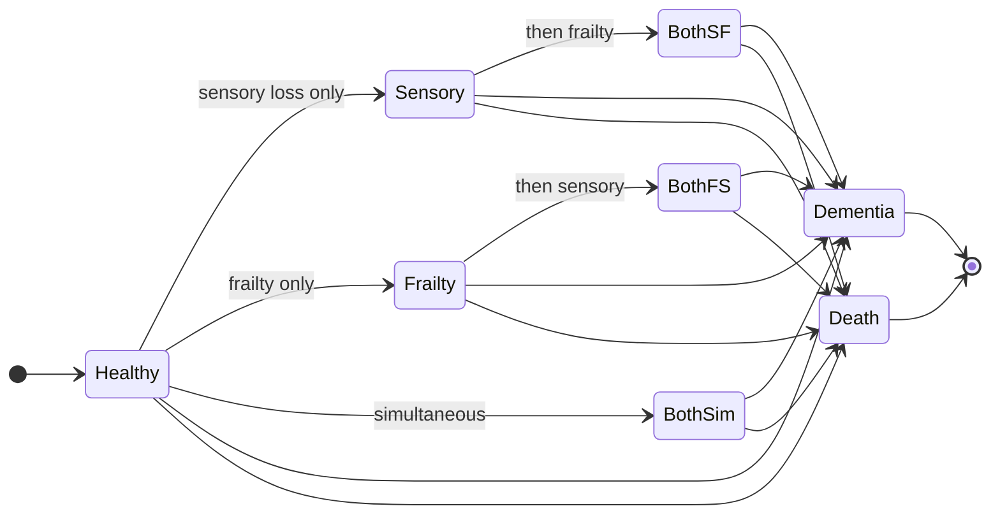

<div align="center">

# Sensory impairment, frailty, and incident dementia

### A two-cohort multi-state analysis in HRS (United States) and ELSA (England)

Reproducible `R` code accompanying the manuscript. The analysis traces how
**hearing and vision loss** and **frailty** accumulate — and in **what order** —
on the path to **incident dementia** and **death** in two large longitudinal
studies of older adults.

<br>


</div>

---

## Overview

Older adults rarely acquire a single deficit in isolation. Sensory impairment
and frailty often co-occur, and the **sequence** in which they arise may carry
different risk for dementia. This repository builds harmonised cohorts from two
independent studies and models the transitions between health states over up to
~16 years of follow-up.

Two exposures (**hearing loss**, **vision loss**) are each analysed against
frailty and dementia, in each cohort, using an identical modelling template so
that findings can be compared across studies.

## The multi-state model at a glance

Each person occupies one of eight mutually exclusive states. Dementia and death
are absorbing. The "both" state is split by **which deficit came first** — the
question at the heart of the paper.



## Methods implemented

| Step | What the code does |
|------|--------------------|
| **Cohort construction** | Harmonises demographics, lifestyle, sensory, and cognition variables into one person-wave table per cohort; applies the eligibility flow (age ≥ 50, dementia-free at baseline, ≥ 2 valid waves, has follow-up). |
| **Frailty index** | Rockwood-style deficit-accumulation index (49 items in ELSA; a comparable index in HRS), requiring ≥ 80% item completeness, with a ≥ 0.25 cut-off for frailty. A sensitivity index removing (I)ADL items is also computed. |
| **Dementia ascertainment** | HRS: Langa–Weir cognitive classification. ELSA: physician diagnosis combined with the 16-item IQCODE (≥ 3.4). Dementia is made irreversible (`cummax`). |
| **Missing data** | Multiple imputation of lifestyle/demographic covariates (`mice`, 20 imputations). |
| **Multi-state models** | 8-state continuous-time Markov models (`msm`) with death as a competing absorbing state; transition-rate ratios and 5- and 10-year transition-probability matrices. |
| **Survival models** | Time-varying Cox proportional-hazards models (counting-process format), models 1–4 with progressive adjustment. |
| **Attributable burden** | Population attributable fractions (PAF). |
| **Figures** | Forest plots, PAF plots, and transition-probability heatmaps for the main text and supplement. |

## Repository structure

```
.
├── code/
│   ├── HRS_dataextract.Rmd    # Build harmonised HRS person-wave data (→ hrs_long.csv)
│   ├── ELSA_extractdata.Rmd   # Build harmonised ELSA person-wave data (→ elsa_long.csv)
│   ├── HRS_analysis.Rmd       # HRS: eligibility, Table 1, msm, Cox
│   ├── ELSA_analysis.Rmd      # ELSA: eligibility, Table 1, msm, Cox
│   └── Plot.Rmd               # Manuscript figures
├── DATA_AVAILABILITY.md       # How to obtain HRS and ELSA data
├── LICENSE                    # MIT
└── README.md
```

> `data/`, `output/`, `results/`, and all `.csv`/`.dta` files are
> **git-ignored** — no participant data ever enter the repository.

## Reproducing the analysis

**1. Requirements** — R ≥ 4.2 and the following packages:

```r
install.packages(c(
  "haven", "dplyr", "tidyverse", "labelled", "stringr", "mice", "lubridate",
  "msm", "survival", "survminer", "scales", "patchwork", "ggalluvial",
  "forestploter", "broom", "car"
))
```

**2. Obtain the data** — HRS and ELSA are restricted-access but free for
approved researchers. Follow [`DATA_AVAILABILITY.md`](DATA_AVAILABILITY.md) and
place the raw files under a local `data/` directory:

```
data/
├── HRS/                       # RAND HRS + Fat/Track/Langa–Weir files
│   ├── randhrs1992_2022v1_STATA/
│   ├── LangaWeir2022v1/
│   ├── trk2022v1/
│   └── h0Nf*_STATA/ ...
└── ELSA/
    └── UKDA-5050-stata/stata/stata13_se/
```

**3. Run in order** — later notebooks read files written by earlier ones:

```
1. code/HRS_dataextract.Rmd    →  data/hrs_long.csv
2. code/ELSA_extractdata.Rmd   →  data/elsa_long.csv
3. code/HRS_analysis.Rmd       →  models + tables (HRS)
4. code/ELSA_analysis.Rmd      →  models + tables (ELSA)
5. code/Plot.Rmd               →  figures
```

## Data availability

No participant-level data are shared here. Both cohorts prohibit
redistribution; obtain them directly from the providers:

- **HRS** — [hrsdata.isr.umich.edu](https://hrsdata.isr.umich.edu) (University of Michigan)
- **ELSA** — [UK Data Service, study SN 5050](https://ukdataservice.ac.uk)

Full file-level details are in [`DATA_AVAILABILITY.md`](DATA_AVAILABILITY.md).

## Citation

If you use this code, please cite the accompanying manuscript.
A full citation and DOI will be added here on publication.

## License

Released under the [MIT License](LICENSE). The license covers the code in this
repository only; it does not grant any rights to the underlying HRS or ELSA data.

## Questions

Please open an [issue](../../issues) rather than emailing, so that answers stay
searchable for others reproducing the work.
